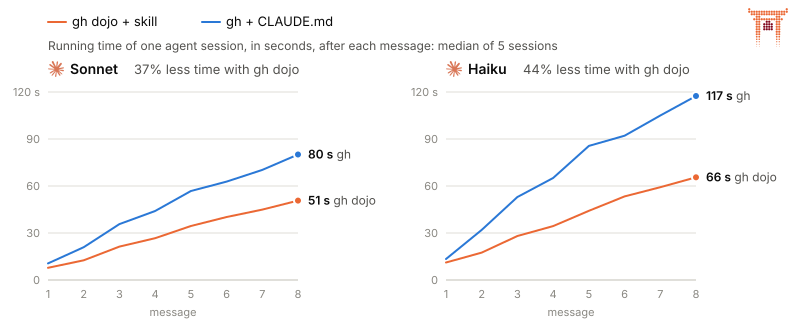

# <picture><source media="(prefers-color-scheme: dark)" srcset="docs/media/logo-dark.svg"></picture> gh-dojo

[](https://github.com/Trum-ok/gh-dojo/actions/workflows/ci.yml)
[](https://github.com/Trum-ok/gh-dojo/releases/latest)
[](go.mod)
[](LICENSE)

**An AI-native [GitHub CLI](https://cli.github.com/) extension for GitHub
Projects.** Your agent says what happened, `gh dojo start 42`, and gh-dojo
applies the process from `.github/dojo.toml`: the status, the comment, the
blockers, the sprint.

Over a day of board work, Claude Code with gh dojo took **37–44% less time**
and **33–44% less money** than with plain `gh` and a careful `CLAUDE.md`, and
got every step right ([benchmark](#benchmark)). Works with **Claude Code**,
**Codex**, **Cursor**, **GitHub Copilot** or any agent with a shell.

<picture>
  <source media="(prefers-color-scheme: dark)" srcset="docs/media/demo-dark.gif">
  
</picture>

## Why

With plain `gh`, an agent can set any board field to any value, and nothing
tells it the process. Agents invent it as they go: they forget to leave a
reason for waiting or move an issue from the wrong status. gh-dojo keeps the
process in the repository as data, and turns it into commands:

<picture>
  <source media="(prefers-color-scheme: dark)" srcset="docs/media/compare-dark.gif">
  
</picture>

gh-dojo is not a planner: it does no sprint planning, standups or reports,
does not replace `gh issue` or `gh pr`, and does not change the board's own
settings.

## Benchmark

Claude Code did a day of board work in one session: eight messages, two of
them traps, the board graded after each. Against plain `gh` with a careful
`CLAUDE.md` (the process, the board's IDs and tested command recipes), gh dojo
took 37–44% less time and 33–44% less money, and got every step right:

<picture>
  <source media="(prefers-color-scheme: dark)" srcset="docs/media/bench-workday-dark.svg">
  
</picture>

The gap widens with every message: with gh the agent writes GraphQL and the
board's IDs, as above, into every command, three to four times the output
tokens, and rereads them all later. For a task of one message the two are
even. Preset kanban, 5 sessions per model, measured on 2026-11-16; the
tasks, numbers and limits are in [docs/bench.md](docs/bench.md).

## Built for agents

- **Process verbs, not fields.** The agent says what happened (`start`,
  `wait`, `ready`); the verb knows the target status, the allowed starting
  statuses, the required arguments, the comment to leave and what else to do
  (sprint, labels, assignee, blocked-by links, closing).
- **One line out, errors that say what to do.** A write prints what was,
  what is now and what was done along the way, so the agent need not re-read
  the issue. An error names the allowed values and the command to run next,
  and each [exit code](docs/output.md#exit-codes) maps to one action, such
  as "ask the user" when the process refuses.
- **Safe retries.** Repeating a command never posts a second comment or
  creates a second issue, and finishes what a failed run left undone.
- **Self-describing.** `gh dojo describe` prints the project's verbs, when to
  use each, the lifecycle and the exit codes in a few lines; `gh dojo next`
  answers "what do I take now".
- **Instructions written from the config.** [`gh dojo agent install`](docs/commands.md#agent-install)
  writes a Claude Code skill, an `AGENTS.md` section (Codex, Cursor and
  others read it) or Copilot instructions, and `--check` in CI catches
  instructions that fell behind the config. Any other agent reads
  `gh dojo describe`.
- **The human decides what is theirs.** A verb with
  [`confirm = "user"`](docs/configuration.md#checks) runs only after the agent
  asks the user, and [`[session]`](docs/configuration.md#session) links each
  comment to the agent session that wrote it.

## Install

```sh
gh extension install Trum-ok/gh-dojo
gh extension upgrade dojo
```

Requires [GitHub CLI](https://cli.github.com/) 2.x. Prebuilt binaries for
macOS, Linux and Windows (amd64 and arm64), with SHA-256 sums and
[build provenance attestations](CONTRIBUTING.md#releases); to build from
source, see [CONTRIBUTING.md](CONTRIBUTING.md#install-from-source).
gh-dojo uses gh's authentication (or `GH_TOKEN`). Projects need the `project`
scope: `gh auth refresh -s project`; [`gh dojo doctor`](docs/commands.md#doctor)
checks it. Boards of users and of organizations are
both supported; for an organization with SAML single sign-on, the token must
also be authorized for it.

## Quick start

1. Give the board's status field the [kanban preset](docs/configuration.md#kanban-preset)
   statuses: Backlog, In progress, Waiting, Ready, Done. To count work in
   sprints, the [sprints preset](docs/configuration.md#sprints-preset) uses
   the same statuses and an iteration field named Sprint.
2. Write `.github/dojo.toml` with [`init`](docs/commands.md#init), in the
   repository:

   ```sh
   gh dojo init                          # lists the owner's projects
   gh dojo init --owner acme --project 3 # writes the config, checks it against the board
   gh dojo init --owner acme --project 3 --preset sprints
   ```

3. Check the setup, read the process the way an agent will, and point your
   agent at it:

   ```sh
   gh dojo doctor          # config, token scope, board, repositories: ok or a fix
   gh dojo describe        # verbs, when to use them, lifecycle, exit codes
   gh dojo agent install   # a Claude Code skill; --agent agents-md,copilot for others
   ```

4. Work:

   ```sh
   gh dojo next            # issues to take: Backlog or no status, not blocked
   gh dojo list            # open issues on the board, grouped by status
   gh dojo show 42         # read an issue before working on it
   gh dojo start 42        # Backlog → In progress, with a comment; --show prints the card too
   gh dojo wait 42 --by 17 # In progress → Waiting, blocked by #17, "Waiting for #17."
   gh dojo ready 42        # → Ready: done and committed, not released
   gh dojo done 42 43      # → Done and closed: released
   ```

## Configuration

A preset gives the verbs; the config names the board and changes or adds
verbs key by key:

```toml
preset = "kanban"            # start, wait, ready, done

[board]
owner = "acme"               # user or org login that owns the project
project = 3                  # project number from its URL

[verbs.start]
blockers = "deny"            # refuse while a blocker is unresolved

[verbs.review]               # a new verb: gh dojo review 42 --by @alice
when = "A pull request is open and waits for review"
from = ["In progress"]
to = "In review"
require = ["by"]
comment = "Review by {by}."
```

Every key, the checks and effects of a verb, comment templates and the
presets: [docs/configuration.md](docs/configuration.md). Complete, commented
configs to start from are in [`examples/`](examples).

## Documentation

- [Commands](docs/commands.md): every command, its flags and output;
  `gh dojo --help` lists them, and each prints its usage with `--help` and
  takes `--json`, `--jq` and `--template`.
- [Configuration](docs/configuration.md): the config format, verbs, presets,
  a process of your own.
- [Output and exit codes](docs/output.md): text output, exit codes, several
  issues at once, `--json`.
- [Benchmark](docs/bench.md): gh dojo against plain gh, with an agent and
  without.
- [Contributing](CONTRIBUTING.md): building, tests, golden files, releases.

## FAQ

**Why a CLI and not an MCP server?** Coding agents already have a shell, so
there is no server to run and no tool schemas in the context: the agent
reads a skill of about 1.6k tokens and runs short commands.

**Will it touch what I didn't ask for?** gh-dojo changes issues, never the
board's own settings, and every command that writes takes `--dry-run`, which
runs the checks and prints the plan. gh-dojo stores no secrets and sends no
telemetry.

**My process is not kanban.** Change a preset's verbs key by key, add your
own, or start without a preset: [your own process](docs/configuration.md#your-own-process),
[examples](examples).

**One board, several repositories?** Yes: list them in
[`board.repos`](docs/configuration.md#board); the first is the default, the
others are named `owner/repo#N`.

**Can people use it too?** Yes, the same commands; the one-line output and
the refusals are as useful to a human as to an agent.

## Status

gh-dojo tracks its own development with gh-dojo. The board is private, but
the comments its verbs leave are on the public
[issues](https://github.com/Trum-ok/gh-dojo/issues?q=is%3Aissue). The
process is [`.github/dojo.toml`](.github/dojo.toml), and its agents read
the skill [`agent install`](docs/commands.md#agent-install) generated from it,
[`.claude/skills/gh-dojo/SKILL.md`](.claude/skills/gh-dojo/SKILL.md). The
config (`version = 1`) and the JSON output (`schema_version: 1`) are
versioned. See the [releases](https://github.com/Trum-ok/gh-dojo/releases);
what comes next, such as hooks for verbs or several agents on one board, is
still an [open question](https://github.com/Trum-ok/gh-dojo/issues?q=is%3Aopen+label%3Aquestion).

## License

[MIT](LICENSE)
